# Shongo · Cómo funciona un RAG, paso a paso

Una explicación interactiva de **RAG (Retrieval-Augmented Generation)**: desde que un archivo entra al sistema hasta que el modelo responde con una cita. Todo corre en el navegador, sin llamadas a APIs de IA ni claves. Hecho con **Vite + TypeScript + GSAP + Three.js + Tailwind CSS**.

**🔗 Ver en vivo: [jhonedinson-shongo.github.io/shongo-rag](https://jhonedinson-shongo.github.io/shongo-rag/)**

[](https://github.com/JhonEdinson-Shongo/shongo-rag/actions/workflows/deploy.yml)


[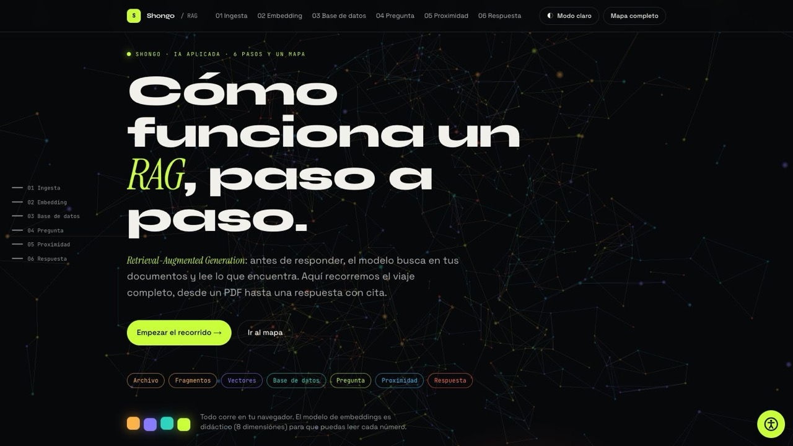](https://jhonedinson-shongo.github.io/shongo-rag/)

## El recorrido

Seis pasos y un mapa. Cada etapa tiene su color, y ese mismo color identifica a un fragmento en el documento, en las tarjetas, en la tabla y en el 3D.

| # | Sección | Qué se ve |
|---|---------|-----------|
| — | El problema | Un LLM sin documentos inventa con seguridad; RAG primero busca, después responde. |
| 01 | Ingesta | El documento se parte en fragmentos. Deslizadores de tamaño y solapamiento; la zona compartida aparece rayada. |
| 02 | Embedding | Texto → tokens → conteo por concepto → vector de 8 números. Escribe cualquier frase. |
| 03 | Base de datos | Anatomía de una fila (`id`, `hash_sha256`, `modelo`, `texto`, `embedding`, `creado_en`), la tabla completa y un experimento: si editas el texto, el hash cambia y hay que re-embeber. |
| 04 | Pregunta | La pregunta pasa por el **mismo** modelo que los fragmentos. |
| 05 | Proximidad | Coseno, producto punto o distancia euclidiana; top-k, umbral y normalización. Espacio vectorial 3D (PCA) para ver las distancias. |
| 06 | Respuesta | El prompt se arma en vivo (sistema + contexto numerado + pregunta). La respuesta cita sus fuentes; si nada supera el umbral, dice que no lo encuentra. |
| — | Mapa completo | Dos carriles (ingesta y consulta) por donde viaja un paquete mientras haces scroll, y el diagrama de un RAG simple. Errores comunes y lo que cambia en producción. |

| 01 · Ingesta | 02 · Embedding |
|---|---|
| 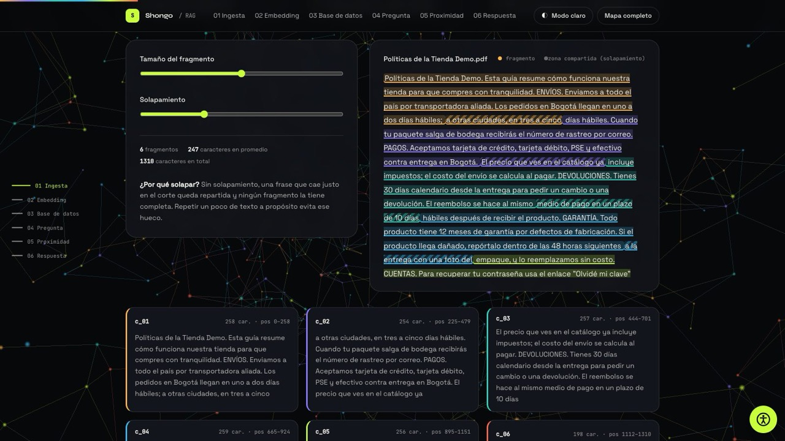 | 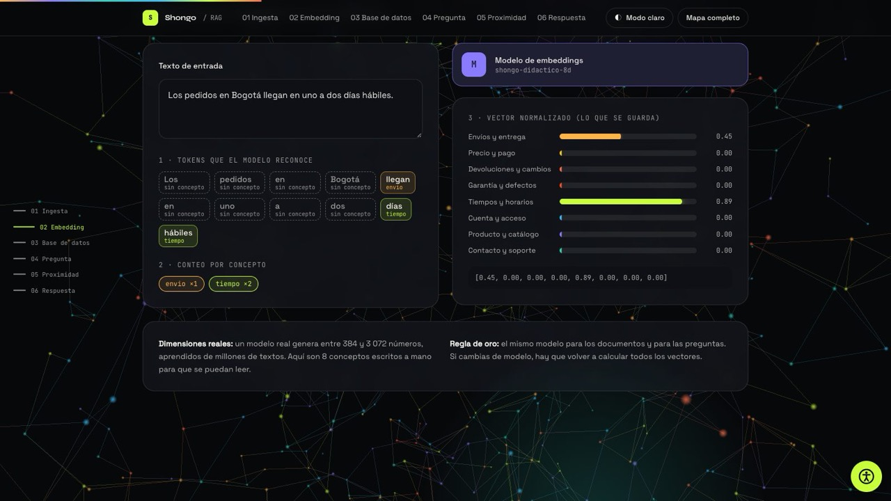 |
| **03 · Base de datos** | **05 · Proximidad** |
| 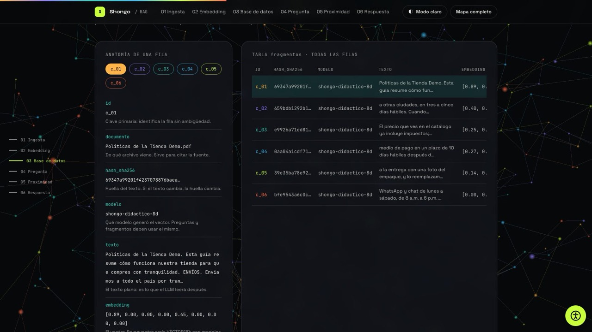 | 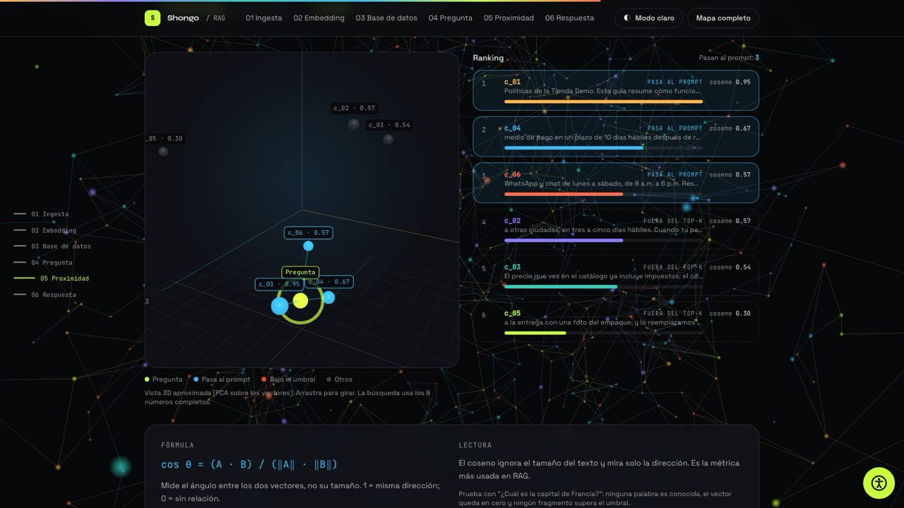 |

### La respuesta

El prompt que recibiría el LLM se arma en vivo con los fragmentos que pasaron el umbral, numerados. La respuesta cita cada fuente con su número y su puntaje.

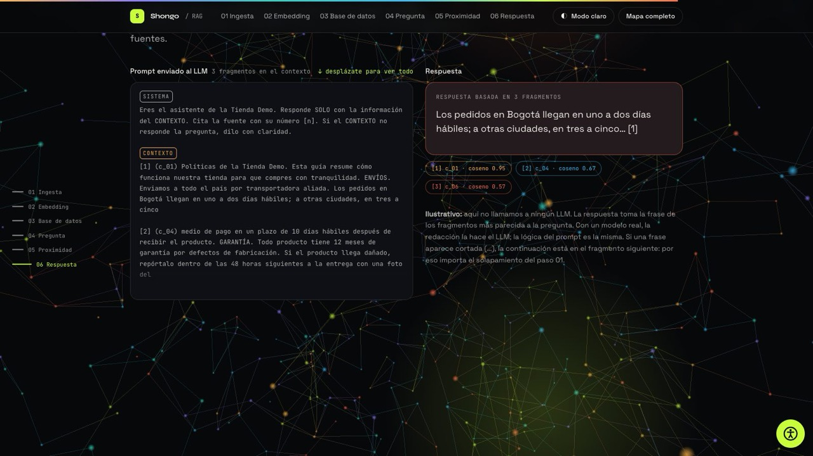

### El mapa completo

Un paquete recorre el sistema mientras haces scroll; cada estación se enciende cuando llega y enlaza a su sección. Debajo, el diagrama de un RAG simple: arriba cómo se prepara la base, abajo cómo responde cada pregunta.

| Mapa del recorrido | Un RAG simple, en un diagrama |
|---|---|
| 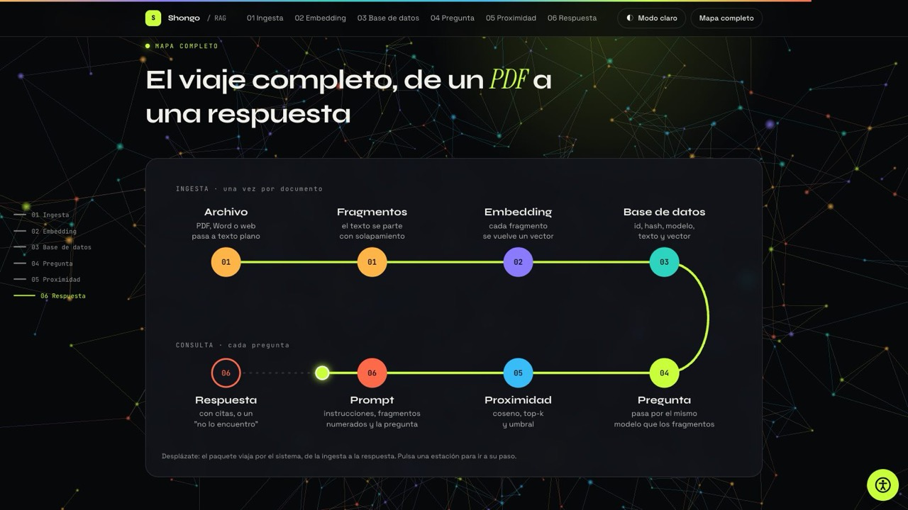 | 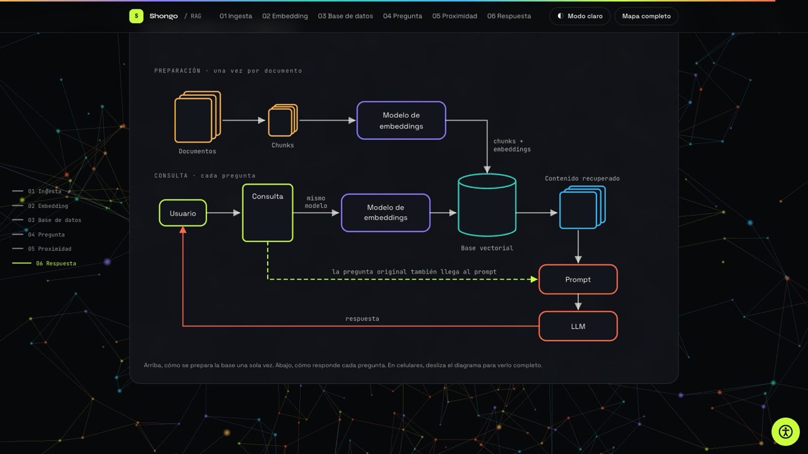 |

### Métricas de distancia

`metricas.html` es una página de apoyo, enlazada desde el paso 05: explica coseno, producto punto, euclidiana, Manhattan, Chebyshev, Minkowski, angular, Jaccard y Hamming, con un ejemplo a mano, una calculadora y las bolas unitarias de cada métrica.

| Portada | Calculadora |
|---|---|
| 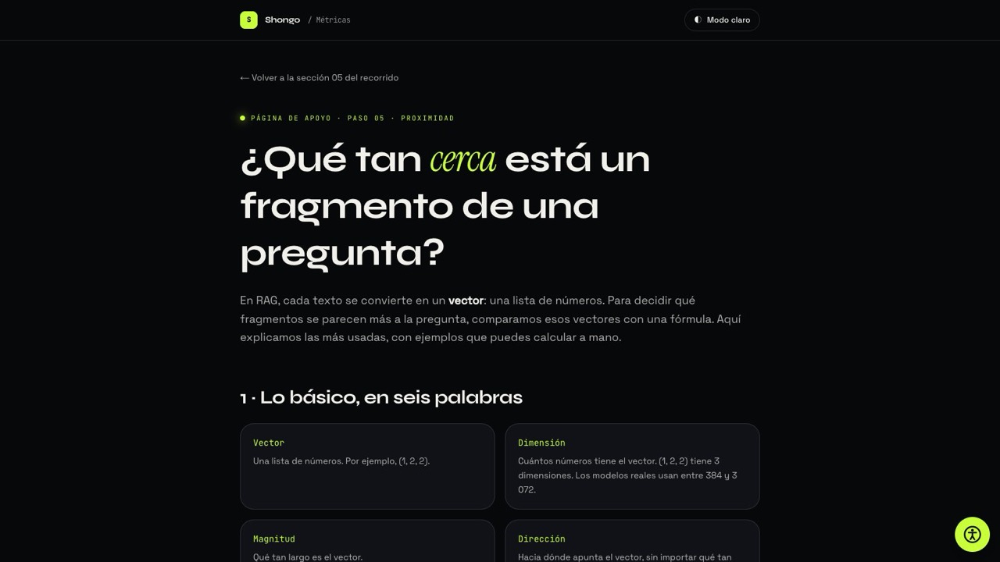 | 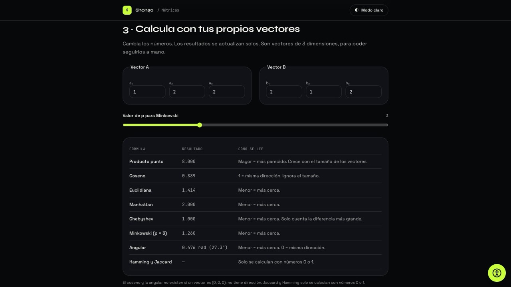 |

### Modo claro

Oscuro por defecto y claro con el botón **Modo claro / Modo oscuro**. Sin elección, la página sigue el modo del sistema; si eliges uno, se recuerda. El 3D también cambia de colores.

| Portada | Proximidad |
|---|---|
| 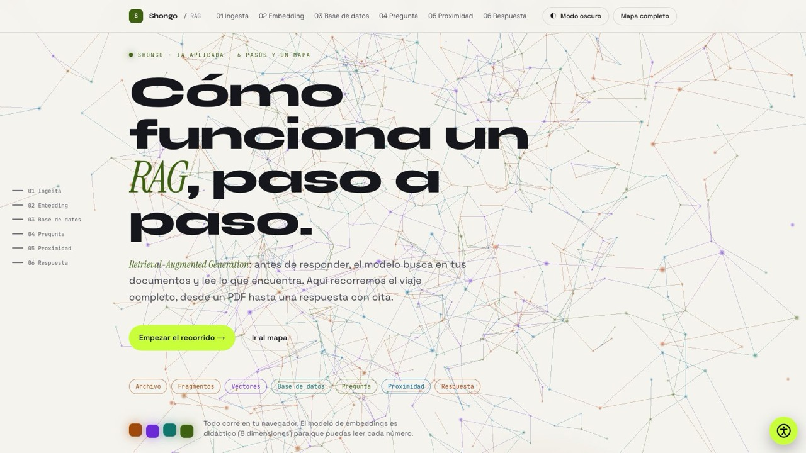 | 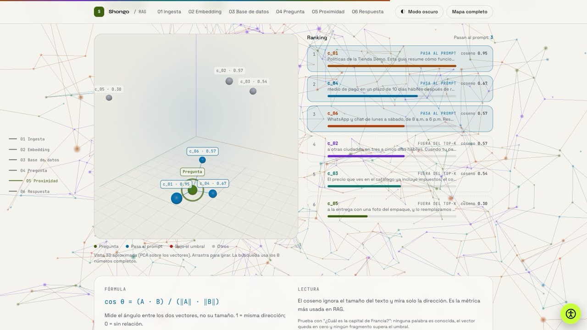 |

### Lectura y accesibilidad

Un botón flotante con el símbolo universal de accesibilidad (abajo a la derecha, en las dos páginas) abre un panel con estas opciones:

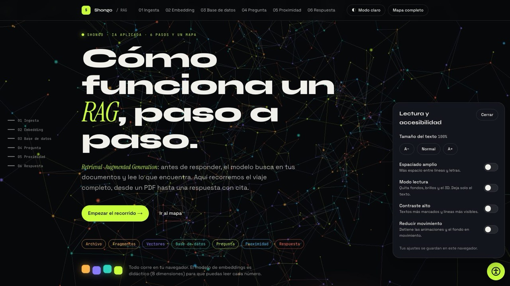

- **Tamaño del texto:** A−, Normal y A+ (de 90 % a 175 %). Afecta a todo el texto de la página.
- **Espaciado amplio:** más espacio entre líneas y letras en el texto corrido. Botones, menús, etiquetas y tablas conservan su medida, para que no se partan ni se desalineen.
- **Modo lectura:** oculta fondos, brillos, barras de progreso y el 3D. Deja el texto en columnas más angostas.
- **Contraste alto:** textos más marcados y líneas más visibles, en ambos modos.
- **Reducir movimiento:** detiene las animaciones, el fondo en movimiento y el scroll suave.

Las preferencias se guardan en el navegador (`localStorage`) y se aplican antes del primer pintado, así que la página no parpadea. El panel se cierra con Escape y el foco vuelve al botón.

Límites conocidos:

- El texto dentro de los diagramas y del mapa tiene tamaño fijo en el SVG: crece con la figura, no con el tamaño de letra del panel.
- Con el texto al 175 % el titular del inicio se limita al ancho de la pantalla, para que ninguna palabra se corte.

### En el celular

| Portada | Proximidad | Respuesta |
|---|---|---|
| 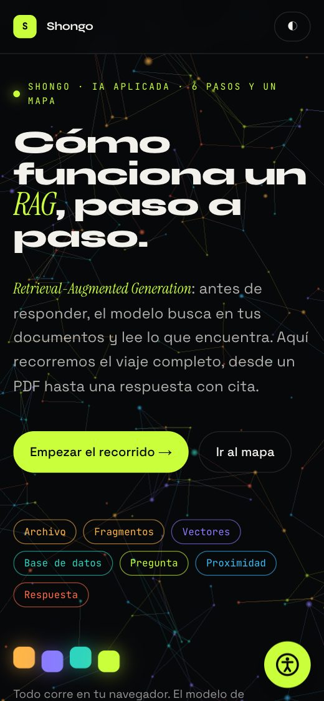 | 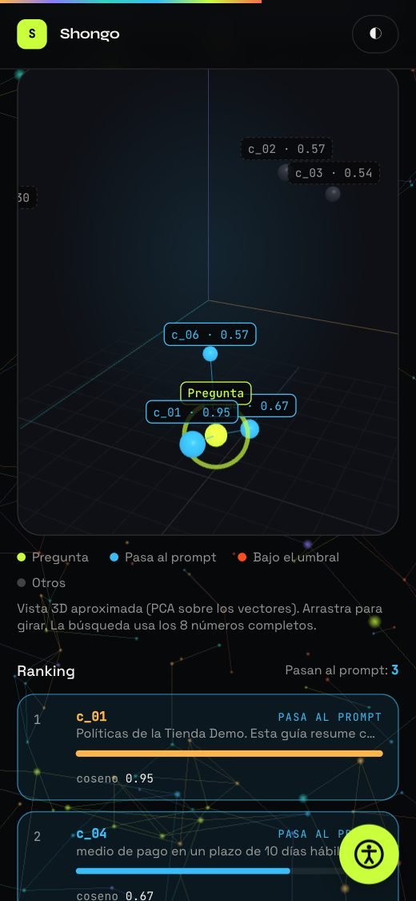 | 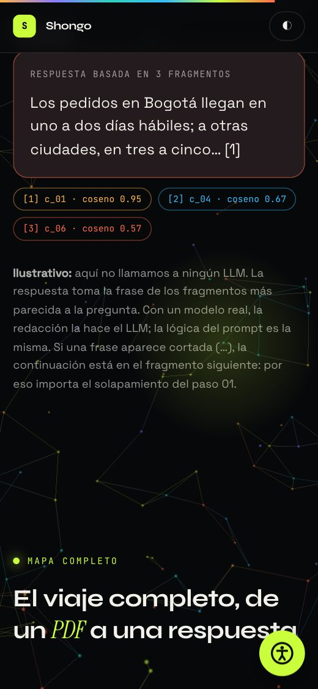 |

### Qué tiene

- **Todo es interactivo:** cambias el tamaño de los fragmentos, escribes tus frases, editas una fila de la base de datos, eliges la métrica, el top-k y el umbral, y el resto del recorrido se recalcula.
- **Un color por etapa:** el mismo fragmento conserva su color en el documento, las tarjetas, la tabla, el ranking y el 3D.
- **Espacio vectorial en 3D:** los vectores de 8 dimensiones se proyectan a 3 con PCA; se puede girar arrastrando.
- **Huella real:** `hash_sha256` se calcula con Web Crypto sobre el texto de cada fragmento.
- **Fondo vivo:** una red de 900 puntos (420 en pantallas pequeñas) que gira con el scroll y se mueve con el mouse.
- **Accesible:** panel de lectura, respeta `prefers-reduced-motion` y contraste AA medido en ambos modos.
- **Rápido:** la portada se anima con CSS, Three.js se descarga después de la carga y el 3D del paso 05 cuando se acerca a la pantalla.
- **Listo para buscadores:** dos páginas con su canónica, datos estructurados y entrada en `sitemap.xml`.

## Qué es real y qué es didáctico

- **Real:** la huella `hash_sha256` (SHA-256 del texto con Web Crypto), la lógica de chunking con solapamiento, las fórmulas de coseno, producto punto y distancia euclidiana, el top-k, el umbral y la construcción del prompt.
- **Didáctico:** el modelo de embeddings. Un modelo real aprende entre 384 y 3 072 números a partir de millones de textos. Aquí son **8 conceptos escritos a mano** (envíos, pago, devoluciones, garantía, tiempos, cuenta, producto, soporte) para que cada número se pueda leer. Está en `src/lib/embed.ts`.
- **Ilustrativo:** la respuesta. No se llama a ningún LLM: se toma la frase de los fragmentos más parecida a la pregunta.
- **Ficticio:** la tienda y sus políticas (`src/lib/corpus.ts`).

## Arrancar

```bash
npm install     # solo la primera vez
npm run dev     # abre la URL que aparece (normalmente http://localhost:5173)
```

Cada vez que guardas un archivo, el navegador se actualiza solo.

> El hash SHA-256 usa Web Crypto, que necesita un contexto seguro (`localhost` o `https`). Si abres el HTML directamente desde el disco, la página usa FNV-1a como respaldo y lo indica con el sufijo `…fnv`.

## Estructura

| Archivo | Qué hace |
|---|---|
| `index.html` | El recorrido: textos y estructura de la portada, los seis pasos y el mapa. |
| `metricas.html` | La página de apoyo sobre métricas de distancia. |
| `src/main.ts` | Arranque del recorrido: fuentes, Lenis, GSAP, estado y secciones. Carga el fondo 3D cuando la página ya está lista. |
| `src/metricas.ts` | La calculadora y las bolas unitarias de `metricas.html`. |
| `src/lib/embed.ts` | El modelo de embeddings didáctico: los 8 conceptos, `tokenInfo` y `embed`. |
| `src/lib/chunk.ts` | Ingesta: fragmentos con tamaño y solapamiento. |
| `src/lib/hash.ts` · `text.ts` | SHA-256 con Web Crypto y respaldo FNV-1a; normalización y tokens. |
| `src/lib/similarity.ts` | Coseno, producto punto, euclidiana y las demás métricas, y el ranking. |
| `src/lib/pca.ts` | Proyección de 8 a 3 dimensiones (PCA por power iteration). |
| `src/lib/state.ts` | La "base de datos" en memoria y la búsqueda con top-k y umbral. |
| `src/lib/corpus.ts` | El documento de ejemplo y las preguntas sugeridas. |
| `src/lib/theme.ts` | Lee la paleta del modo activo para pasarla a Three.js. |
| `src/sections/` | Una función `init` por paso (`ingesta`, `embedding`, `database`, `pregunta`, `proximidad`, `respuesta`), más `mapa`, `diagrama` y `chrome` (barra de progreso, pasos activos y revelados). |
| `src/three/background.ts` | La red de puntos del fondo. |
| `src/three/space.ts` | El espacio vectorial 3D: pregunta, fragmentos, etiquetas y líneas. |
| `src/ui/access.ts` | El panel de lectura y accesibilidad. |
| `src/ui/mode.ts` | Modo claro y oscuro: botón, recuerdo y aviso a Three.js. |
| `src/ui/dom.ts` | Helpers: barras de vector, chips de tokens y escape de HTML. |
| `src/styles/main.css` | Paleta (`@theme`), componentes y estilos del 3D. |
| `vite.config.ts` | Las dos páginas del build y el plugin de SEO (canónica, Open Graph, JSON-LD, `robots.txt` y `sitemap.xml`). |
| `public/` | Archivos que se copian tal cual: la imagen para redes. |

## Conceptos clave

1. **El mismo modelo para todo.** Los fragmentos y la pregunta pasan por el mismo modelo de embeddings. Si cambias de modelo, hay que volver a calcular todos los vectores.
2. **El solapamiento evita huecos.** Sin él, una frase que cae justo en el corte queda repartida y ningún fragmento la tiene completa.
3. **La huella dice qué recalcular.** Cada fila guarda el `hash_sha256` de su texto y el modelo que la generó. Si el texto cambia, el hash cambia y esa fila se vuelve a embeber.
4. **Cercanía = parecido.** El coseno mide el ángulo entre dos vectores e ignora su tamaño; por eso es la métrica más usada en RAG. Con vectores normalizados, coseno y producto punto dan el mismo orden.
5. **Top-k y umbral filtran el contexto.** Se toman los k fragmentos más cercanos y se descartan los que no superan el umbral. Si ninguno pasa, la respuesta correcta es "no lo encuentro".
6. **El prompt es la pieza final.** Instrucciones del sistema + fragmentos numerados + la pregunta. El LLM cita con el número de cada fragmento.

## Diseño

### Paleta: "Shongo RAG"

| Token | Oscuro | Claro | Uso |
|-------|--------|-------|-----|
| `ground` | `#07080a` | `#f5f4ef` | Fondo |
| `ground-2` | `#0e1015` | `#ebeae3` | Código, entradas y espacio 3D |
| `card` | `#12151b` | `#fcfbf8` | Tarjetas |
| `ink` | `#f3f1ec` | `#16171c` | Texto principal |
| `ink-dim` | tinta al 72 % | `#454852` | Texto secundario |
| `ink-faint` | tinta al 60 % | `#5a5e68` | Notas y etiquetas |
| `acid` | `#c9ff3b` | `#3f6212` | Marca Shongo, énfasis y **la pregunta** (en claro se oscurece para leerse) |
| `fill-acid` | `#c9ff3b` | `#c9ff3b` | Relleno de botones, con texto oscuro encima |
| `ingesta` | `#ffb547` | `#a04a0a` | Archivo y fragmentos |
| `gold` | `#facc15` | `#854d0e` | Concepto "precio y pago" |
| `embed` | `#8b7bff` | `#6d28d9` | Modelo de embeddings |
| `db` | `#2dd4bf` | `#0f766e` | Base de datos |
| `sky` | `#38bdf8` | `#0369a1` | Proximidad y "pasa al prompt" |
| `coral` | `#ff6b4a` | `#b53f0c` | Respuesta |
| `brasa` | `#ff4d1c` | `#b91c1c` | Errores y "bajo el umbral" |

**Contraste.** La página se audita con WCAG AA: 4.5:1 para texto normal y 3:1 para texto grande. En cada modo se miden 442 textos visibles, con el color final de cada elemento (fondos apilados, opacidad y transparencias incluidas): **0 incumplen**, también con contraste alto, modo lectura y texto grande. Los acentos del modo claro son versiones oscurecidas de los del oscuro, para que el texto cumpla sobre papel.

**Tipografía** (la misma familia de `shongo-memoria`): Syne para titulares, Instrument Serif itálica para el énfasis, Space Grotesk para el cuerpo y JetBrains Mono para código, IDs y números.

**Movimiento:** GSAP ScrollTrigger revela cada bloque al entrar; las barras de vector crecen con `power3.out`; el texto de la respuesta se escribe carácter a carácter. Con `prefers-reduced-motion` (o el panel) se desactivan las animaciones continuas y el scroll suave.

## Publicar

Cada push a `main` compila el proyecto y lo publica en GitHub Pages con el workflow `.github/workflows/deploy.yml`. También se puede lanzar a mano desde la pestaña **Actions**.

- En GitHub, **Settings → Pages → Source** debe estar en **"GitHub Actions"**.
- `vite.config.ts` usa `base: './'`, así que el mismo build funciona en `usuario.github.io/repo/` y en un dominio propio.
- GitHub Pages sirve por HTTPS, que es lo que Web Crypto necesita para el SHA-256.

Para probar el build en local:

```bash
npm run build     # revisa los tipos con tsc y genera dist/
npm run preview   # lo sirve tal como quedará publicado
```

### SEO y rendimiento

- **URL pública automática:** el workflow pasa la URL de GitHub Pages (`SITE_URL`) al build. Con ella se generan la URL canónica, Open Graph, Twitter Card, el JSON-LD, `robots.txt` y `sitemap.xml`. En local, sin `SITE_URL`, se omiten las etiquetas con URL absoluta.
- **Dos páginas indexables:** `index.html` y `metricas.html`, cada una con su canónica y su entrada en el sitemap.
- **Datos estructurados:** `WebSite` y `TechArticle`.
- **Imagen para redes:** `public/og-image.png` (1200×630), tomada de la portada.
- **Fuentes propias** (`@fontsource`, solo caracteres latinos) con respaldo ajustado a las mismas medidas, para que el texto no salte al cargar.
- **Lighthouse (sitio publicado, inicio):** celular: rendimiento 100, LCP 1.3 s, CLS 0; escritorio: rendimiento 99, LCP 0.7 s. Accesibilidad, buenas prácticas y SEO en 100 en ambos. `metricas.html` queda con CLS 0.002.
- **Respaldos de fuentes medidos por peso:** Syne 800 y Syne 700 tienen anchos muy distintos, así que cada una tiene su propio respaldo (`src/styles/main.css`). Sin eso, el título de `metricas.html` se partía en más líneas mientras cargaba la fuente y la página saltaba (CLS 0.207).
- Envía `sitemap.xml` en [Google Search Console](https://search.google.com/search-console) y pide la indexación de la URL principal. Google puede tardar días en mostrar el sitio.

## Notas para producción

Esta página enseña la idea. Un sistema real cambia estas piezas:

- Vectores de un modelo de embeddings real (con la misma familia para documentos y preguntas).
- Base vectorial: pgvector, Qdrant u otra, con índice HNSW para buscar en millones de fragmentos.
- Un LLM que redacta la respuesta a partir del prompt, con evaluación de calidad.
- Reranker opcional sobre los top-k y control de permisos por fragmento.

## Créditos

- Tipografías: Syne, Instrument Serif, Space Grotesk y JetBrains Mono (licencia OFL), servidas desde el propio sitio con `@fontsource`.
- La tienda y sus políticas son ficticias, y el modelo de 8 conceptos es didáctico: ambos se escribieron para este recorrido.

---

Hecho por [Jhon Castañeda](https://jhoncastaneda.vercel.app/es) · [GitHub](https://github.com/JhonEdinson-Shongo) · [LinkedIn](https://www.linkedin.com/in/jhon-edinson-casta%C3%B1eda-oviedo-6a78311ab)
